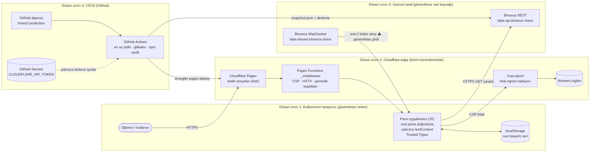

# Canlı Kripto Piyasa Panosu

Beş kripto varlığın (BTC, ETH, BNB, SOL, XRP) fiyatını **WebSocket ile canlı** izleyen, bağlantı koptuğunda kendini toparlayan ve varlıklar arası **24 saatlik getiri korelasyonunu** gösteren eğitim amaçlı karar destek panosu. Sıkı CSP, Trusted Types ve gelen her mesaja şema doğrulamasıyla Cloudflare'de yayında.

- **Canlı:** https://kripto-piyasa-panosu.pages.dev
- **Vaka çalışması ve demo videosu:** https://ardaalacamli.vercel.app/projeler/kripto-piyasa-panosu
- **Kullanıcı testi:** [`docs/kullanici-testi.md`](docs/kullanici-testi.md) · **Güvenlik raporu:** [`docs/guvenlik-raporu.pdf`](docs/guvenlik-raporu.pdf)
- Kurgusal müşteri: Bir üniversite finans kulübü (eğitim amaçlı). Gerçek bir kurumla iş birliği değildir.
- ⚠️ **Bilgilendirme amaçlıdır, yatırım tavsiyesi değildir.** Resmî bilgi için: [SPK](https://spk.gov.tr)

## CV cümleleri

**Arayüz (BVA 2245):** Binance WebSocket akışından beslenen, bağlantı koptuğunda otomatik yeniden bağlanan ve API kapalıyken son başarılı veriyle açılan gerçek zamanlı kripto panosu geliştirdim; 5 varlığın getiri korelasyonunu hesapladım (D3.js, zod, PWA, 360–1440 px).

**Bulut güvenliği:** Canlı veri panomu Cloudflare Pages'e wrangler.toml ve GitHub Actions ile taşıdım; edge'de sıkı CSP (unsafe-inline yok, connect-src yalnızca 2 adres) ve Trusted Types kurdum, sahte WebSocket sunucusundan gönderilen 11 zararlı yükün 11'ini de engelledim.

## Mimari



| Katman | Ne yapıyor |
|---|---|
| **Veri kaynağı** | Binance herkese açık piyasa verisi: REST `data-api.binance.vision` (geçmiş fiyat, 24 saat özeti) + WebSocket `data-stream.binance.vision` (canlı ticker). **Anahtar gerekmez.** |
| **Tarayıcı** | Vite + saf JS + D3. REST 5 dakikada bir, WebSocket sürekli. Her mesaj `zod` şemasından geçer. DOM'a yalnızca `textContent` yazılır. Son başarılı veri `localStorage`'da tutulur. |
| **Edge** | Cloudflare Pages (statik) + Pages Functions: `_middleware.js` güvenlik başlıklarını ekler, `csp-report.js` ihlalleri loglar. |
| **CI/CD** | GitHub Actions: CI (gitleaks, npm audit, DOM kontrolü) → günlük anlık görüntü + derleme → `wrangler pages deploy`. Saatlik izleme ve kullanım alarmı. |

**Veri hattı:** Ders "tarayıcıdan doğrudan API çağrısı" ya da "Actions ile JSON" seçeneklerinden birini istiyor; bu proje ikisini birlikte kullanıyor. Canlı veri tarayıcıdan geliyor. GitHub Actions her gün 06:17'de (`deploy.yml` cron) `public/data/snapshot.json` dosyasını üretip siteyle birlikte yayınlıyor. API çalışmadığında pano önce tarayıcı önbelleğindeki, o da yoksa bu dosyadaki son başarılı veriyle açılıyor ve bunu ekranda açıkça söylüyor.

**Veri kaynağı ve lisans:** [Binance Spot API: Market Data](https://developers.binance.com/docs/binance-spot-api-docs/rest-api/market-data-endpoints) herkese açık, anahtarsız uç noktaları; [Binance kullanım koşulları](https://www.binance.com/en/terms) geçerlidir. Hız sınırına uyulur: REST en fazla 5 dakikada bir (birkaç istek), WebSocket tek bağlantı. Binance logosu ve marka görselleri kullanılmaz.

## Özellikler (ödev kartı)

- ✅ WebSocket ile gerçek zamanlı fiyat akışı (5 varlık, birleşik akış)
- ✅ Otomatik yeniden bağlanma: Üstel geri çekilme + rastgele sapma (1 sn → 30 sn), 20 sn sessizlik izleyicisi, çevrimdışı/çevrimiçi olayları
- ✅ Görünür bağlantı durumu: Canlı / bağlanıyor / "X sn içinde yeniden denenecek (n. deneme)" / çevrimdışı + "Şimdi yeniden bağlan" düğmesi
- ✅ 5 varlığın 24 saatlik getiri korelasyon matrisi (5 dakikalık log getiriler, Pearson; her hücrede sayı)
- ✅ Koyu tema; artış **mavi + ▲**, düşüş **turuncu + ▼**; "yatırım tavsiyesi değildir" notu
- 3 KPI kartı, ana grafik (fiyat seyri, 1/7/30 gün), ikincil grafik (24 sa getiri), filtre paneli, sıralanabilir tablo
- Yükleniyor (iskelet), boş sonuç ve hata durumları; API kapalıyken son veriyle açılış
- Erişilebilirlik: Klavye (grafikte ← →, Home/End), görünür odak, her grafikte otomatik özet + "veriyi tablo olarak gör", kontrast ≥ 4,5:1
- PWA olarak yüklenebilir (manifest + servis çalışanı)

## Güvenlik

| Belge | |
|---|---|
| Tehdit modeli (STRIDE, 11 tehdit) | [`docs/tehdit-modeli.md`](docs/tehdit-modeli.md) |
| En az yetki ve elle kurulan kaynaklar | [`docs/en-az-yetki.md`](docs/en-az-yetki.md) |
| Runbook: "API anahtarım sızdı" | [`docs/runbook-anahtar-sizdi.md`](docs/runbook-anahtar-sizdi.md) |
| Kart doğrulama testi ve kanıtlar | [`test/security-test.mjs`](test/security-test.mjs) · [`test/evidence/`](test/evidence/) |
| Açık bildirimi | [`SECURITY.md`](SECURITY.md) · [`/.well-known/security.txt`](public/.well-known/security.txt) |

## Kurulum

```bash
npm install
npm run dev              # http://localhost:5173 (gerçek Binance verisiyle)
npm run build            # dist/
npm run preview          # Cloudflare Pages yerel (güvenlik başlıklarıyla) http://localhost:8788
npm run check:dom        # innerHTML / eval gibi tehlikeli ifadeleri arar
npx playwright install chromium
npm run test:security    # sahte WebSocket sunucusu + zararlı yükler + CSP raporu → test/evidence/
```

Yayın için GitHub Secrets: `CLOUDFLARE_API_TOKEN` (yalnızca Cloudflare Pages: Edit), `CLOUDFLARE_ACCOUNT_ID`, `CLOUDFLARE_ANALYTICS_TOKEN` (yalnızca Account Analytics: Read).

## Yapay zekâ kullanım beyanı

Bu projede **Claude (Anthropic)** kullanıldı.
- **Hangi iş için:** Uygulama kodunun (WebSocket istemcisi, şemalar, D3 grafikleri, arayüz), edge güvenlik başlıklarının, GitHub Actions iş akışlarının, güvenlik testinin ve belgelerin (tehdit modeli, runbook) hazırlanması.
- **Doğrulama:** Güvenlik testi gerçek bir tarayıcıda (Chromium) çalıştırıldı ve 24/24 kontrol geçti. Test sırasında üç sorun bulunup düzeltildi: zod'un `Function()` yoklaması her açılışta CSP ihlali üretiyordu (jitless moda alındı); servis çalışanı kaydı Trusted Types'a takılıyordu (tek izinli `sw` politikası eklendi); `report-to` raporları geciktiriyordu (`report-uri` kullanıldı).
- **Benim katkım:** Cloudflare ve GitHub hesaplarını, API token'larını (en az yetkiyle), GitHub güvenlik ayarlarını, branch protection'ı ve bütçe alarmını kendim kurdum; PR'ları inceleyip birleştirdim. Kullanıcı testini iki sınıf arkadaşımla yaptım; bulgulara göre "Bugün öne çıkanlar" eklendi. Ekran görüntülerini, Lighthouse, Observatory ve securityheaders ölçümlerini ve demo videosunu kendi sistemimde aldım, videonun altyazı metinlerini düzenledim. Kodu satır satır ben yazmadım; her bileşenin ne yaptığını ve neden öyle yapıldığını çalışarak öğrendim.
